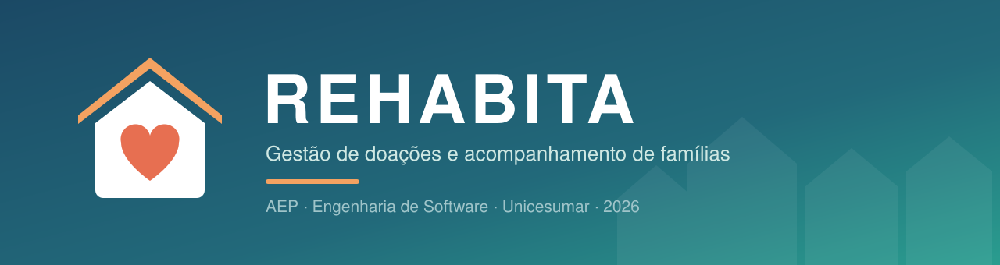

<p align="center">
  <picture>
    <source media="(prefers-color-scheme: dark)" srcset="docs/assets/banner-dark.svg">
    
  </picture>
</p>

<p align="center">
  
  
  
  
  
</p>

<p align="center">
  <b>Um lugar só para a doação que chega, a família que precisa e a ajuda que foi entregue.</b>
</p>

---

## Propósito

> **Missão.** Tirar do improviso o trabalho de quem já ajuda, para que o pouco que chega vá para quem mais precisa.

Paróquias, igrejas e projetos sociais de Maringá recebem doações o tempo todo e repassam para famílias da comunidade. O trabalho existe e funciona. O que falta é memória: quando o voluntário troca ou a procura aumenta, a informação se perde.

O REHABITA não substitui ninguém. Ele só guarda o que hoje está espalhado em cadernos, planilhas e conversas de WhatsApp.

| | Antes | Com o REHABITA |
|---|---|---|
| **Quantas cestas ainda temos?** | Alguém precisa ir contar no depósito. | Saldo de cada item, atualizado a cada entrada e saída. |
| **Essa família já recebeu este mês?** | Depende de alguém lembrar. | O sistema avisa quando a entrega se repete em menos de 30 dias. |
| **Quem fez a última visita?** | Está no caderno de alguém. | Histórico da família com data, responsável e observações. |
| **Quem atender primeiro?** | Quem chegou primeiro. | Lista de prioridade por urgência e por tempo sem receber. |
| **O que foi feito com o que doei?** | Difícil prestar contas. | Toda doação e toda entrega ficam registradas. |

| | |
|---|---|
| **Quem usa** | Coordenação e assistentes sociais/voluntários da instituição |
| **Quem não acessa** | Doadores e famílias assistidas |
| **Entidade principal** | Família (CRUD completo) |
| **Contexto acadêmico** | AEP do 4º semestre (2026) – Unicesumar, Maringá/PR |

Documento completo da 1ª entrega: [`docs/AEP2026_4_REHABITA.pdf`](docs/AEP2026_4_REHABITA.pdf)

---

## Índice

| Planejamento | Técnico | Projeto |
|---|---|---|
| [ODS da ONU](#ods-da-onu) | [Arquitetura](#arquitetura) | [Estrutura do repositório](#estrutura-do-repositório) |
| [Problemas que resolve](#problemas-que-o-sistema-resolve) | [Modelo de dados](#modelo-de-dados) | [Como executar](#como-executar) |
| [Requisitos](#requisitos) | [Tecnologias](#tecnologias) | [Roadmap](#roadmap) |
| [Regras de negócio](#regras-de-negócio) | [Pilares de POO](#pilares-de-poo) | [Cronograma](#cronograma) |
| | | [Equipe](#equipe) |

---

## ODS da ONU

| ODS | Como o REHABITA contribui |
|-----|---------------------------|
| **1 – Erradicação da Pobreza** | Cada família tem status, histórico de visitas e data de retorno, então fica visível quem está há muito tempo sem atendimento. |
| **2 – Fome Zero** | O controle de estoque avisa que a cesta básica está acabando antes de faltar. |
| **10 – Redução das Desigualdades** | A lista de prioridade e o aviso de entrega repetida distribuem a ajuda por critério, não por ordem de chegada. |

---

## Problemas que o sistema resolve

| Dor | Por que acontece | Resposta do sistema |
|-----|------------------|---------------------|
| A informação da família se perde ou precisa ser perguntada de novo a cada visita. | Os dados ficam em cadernos, planilhas e conversas de WhatsApp, e cada voluntário tem a sua versão. | Cadastro único da família e dos membros (R1, R2). |
| Algumas famílias recebem duas vezes no mesmo mês e outras ficam sem nada. | Não existe um lugar onde dê para ver o que cada família já recebeu e quando. | Histórico de entregas e aviso de entrega repetida (R6, RN4). |
| Casos urgentes esperam na mesma fila que os outros. | Não há um jeito combinado de marcar urgência nem de lembrar quem precisa de retorno. | Nível de urgência, data de retorno e lista de prioridade (R3, R9, RN7). |
| A coordenação não sabe quanto tem em estoque nem quando algo vai acabar. | As doações chegam por vários lados e são guardadas sem anotar entrada e saída. | Registro das doações recebidas e saldo por item (R4, R5, RN3). |
| É difícil prestar contas para quem doou e para a própria instituição. | Nada liga o que entrou com o que foi entregue. | Doações e entregas ficam gravadas com data e responsável (R5, R6). |
| Não dá para saber quais bairros concentram mais famílias atendidas. | O endereço é anotado de qualquer jeito, então não dá para agrupar. | Bairro escolhido de uma lista e consulta por bairro (R1, R9). |

---

## Requisitos

| Nº | Requisito |
|:--:|-----------|
| **R1** | O sistema deve permitir o cadastro de famílias assistidas, com os dados do responsável (nome completo, CPF, data de nascimento, telefone, escolaridade e situação de trabalho), o endereço (CEP, rua, número, complemento e bairro), o tipo de moradia e a faixa de renda, além de consultar, editar e excluir esse cadastro. |
| **R2** | O sistema deve permitir o cadastro dos membros de cada família, com nome completo, data de nascimento, grau de parentesco com o responsável, telefone e CPF (esses dois opcionais), calculando automaticamente quantas pessoas moram na casa. |
| **R3** | O sistema deve permitir o registro dos atendimentos e visitas feitos a cada família, com data da visita, nível de urgência (baixa, média ou alta), usuário que atendeu, observações e data prevista para o retorno. |
| **R4** | O sistema deve permitir o cadastro dos itens distribuídos pela instituição (ex.: cesta básica, kit de higiene, fralda, cobertor), com nome, categoria (alimento, higiene, vestuário ou outros) e unidade de medida, mostrando o saldo atual em estoque de cada item. |
| **R5** | O sistema deve permitir o registro das doações recebidas, com data, doador (pessoa física, empresa, instituição ou doação anônima) e os itens com suas quantidades, somando essas quantidades ao estoque. |
| **R6** | O sistema deve permitir o registro dos itens entregues à família em cada atendimento, com a quantidade, descontando do estoque e mantendo o histórico de tudo o que a família já recebeu. |
| **R7** | O sistema deve permitir a alteração do status de acompanhamento da família (Novo, Em acompanhamento ou Inativo), guardando a data, o usuário e o motivo de cada mudança. |
| **R8** | O sistema deve permitir o cadastro de usuários (nome, CPF, telefone, e-mail, senha e perfil) e o login com e-mail e senha, com dois perfis: coordenador, que acessa tudo e é o único que cadastra usuários, itens e bairros, e assistente social, que trabalha com famílias, atendimentos, entregas, doações e consultas. |
| **R9** | O sistema deve permitir consultar as famílias por bairro, status e nível de urgência, gerar a lista de prioridade de atendimento e o relatório de saldo dos itens em estoque. |

---

## Regras de negócio

Implementadas na camada `service` e, quando possível, reforçadas por restrições no próprio banco.

| Código | Regra | Requisito |
|:------:|-------|:---------:|
| **RN1** | Não pode existir duas famílias com o mesmo CPF de responsável. Se o CPF já estiver cadastrado, o sistema mostra a família que já existe em vez de criar outra. | R1 |
| **RN2** | A quantidade de pessoas da família não é digitada: é o responsável mais os membros cadastrados. | R2 |
| **RN3** | O saldo de um item só muda por doação recebida (entrada) ou por entrega (saída), nunca é editado à mão. A entrega só é gravada se houver saldo suficiente, e o registro da entrega e a baixa no estoque são salvos juntos: se um falhar, nenhum dos dois é salvo. | R4, R5, R6 |
| **RN4** | Se a família já recebeu o mesmo item nos últimos 30 dias (a cesta básica costuma ser mensal), o sistema avisa. A entrega só continua se o atendimento estiver marcado com urgência alta. | R6 |
| **RN5** | Toda família começa com status Novo e passa para Em acompanhamento no primeiro atendimento. Qualquer mudança manual de status exige um motivo e fica gravada no histórico. | R3, R7 |
| **RN6** | Família que já tem atendimento registrado não pode ser excluída, só inativada, para não apagar o histórico de entregas. | R1, R7 |
| **RN7** | A lista de prioridade mostra as famílias que não estão inativas, ordenadas pela urgência do último atendimento e, em caso de empate, por quem está há mais tempo sem receber entrega. Família com status Novo entra como urgência média até receber a primeira visita. | R9 |

---

## Arquitetura

O sistema funciona como uma aplicação de console em Java, onde toda a interação acontece pelo terminal. A classe `Main` demonstra os pilares de POO e executa as operações de CRUD chamando a camada de serviço.

```
        Main (console)
              |
          service            regras de negócio (RN1 a RN7) e transações
              |
            dao              única camada que executa SQL (JDBC puro)
              |
         SQL Server
```

| Pacote | Responsabilidade | Exemplos |
|--------|------------------|----------|
| `model` | Guarda as classes do sistema: entidades, classes abstratas e enums. | Familia, Pessoa (abstrata), Membro, StatusFamilia |
| `service` | Onde ficam as regras de negócio (RN1 a RN7). | FamiliaService |
| `dao` | A única parte que conversa com o banco de dados, via JDBC puro com `PreparedStatement`. Todos implementam a interface genérica `Dao<T>` com `@Override`. | FamiliaDao, UsuarioDao, AtendimentoDao |
| `util` | Coisas usadas por várias camadas. | ConexaoBanco (conexão `static` com SQL Server) |

**Padrões aplicados**

- **Camadas** — a `Main` não conhece SQL e o DAO não conhece regra de negócio.
- **DAO** — todos os DAOs implementam a interface genérica `Dao<T>` com `@Override`, expondo as cinco operações do CRUD: `inserir`, `buscarPorId`, `listarTodos`, `atualizar` e `excluir`.
- **Herança e polimorfismo** — `Pessoa` (abstrata) é herdada por `Responsavel`, `Membro` e `Usuario`; `MovimentacaoItem` (abstrata) é herdada por `ItemRecebido` e `ItemEntregue`, que sobrescrevem `aplicarNoEstoque()` de formas opostas (uma soma, a outra desconta).
- **Consultas parametrizadas** — todo acesso ao banco usa `PreparedStatement`, nunca concatenação de texto, o que previne SQL injection.

<details>
<summary><b>Ver diagrama de classes</b></summary>

<p align="center">
  
</p>

</details>

<details>
<summary><b>Ver organização em camadas</b></summary>

<p align="center">
  
</p>

</details>

> Arquivos editáveis (`.asta`) e em PDF na pasta [`docs/Diagramas/`](docs/Diagramas).

---

## Pilares de POO

O projeto demonstra todos os pilares exigidos na AEP:

| Pilar | Onde está | Exemplo no código |
|-------|-----------|-------------------|
| **Herança** | `Pessoa` → `Responsavel`, `Membro`, `Usuario`; `MovimentacaoItem` → `ItemRecebido`, `ItemEntregue` | `public class Responsavel extends Pessoa` |
| **Polimorfismo** | `aplicarNoEstoque()` é sobrescrito de formas opostas nas subclasses | `ItemRecebido` soma, `ItemEntregue` desconta |
| **Abstração** | Classes abstratas `Pessoa` e `MovimentacaoItem` | `public abstract class Pessoa` |
| **Interface** | `Dao<T>` com 5 métodos CRUD | `public interface Dao<T>` |
| **Implements** | Todos os DAOs implementam `Dao<T>` | `public class FamiliaDao implements Dao<Familia>` |
| **@Override** | Em todas as implementações de interface e sobrescritas de métodos abstratos | `@Override public void inserir(Familia f)` |
| **Tratamento de erros** | `try-with-resources` em todas as conexões JDBC | `try (Connection conn = ConexaoBanco.getConexao())` |
| **Static** | Método de conexão com o banco | `public static Connection getConexao()` |

---

## Modelo de dados

11 tabelas no SQL Server. Correspondência entre as classes Java e as tabelas:

| Classe (Java) | Tabela | Observação |
|---------------|--------|------------|
| `Pessoa` | – | Classe abstrata: não vira tabela. |
| `Responsavel` | `familia` | Fica dentro da tabela da família. |
| `Membro` | `membro_familia` |  |
| `Usuario` | `usuario` |  |
| `Familia` | `familia` |  |
| `Bairro` | `bairro` |  |
| `HistoricoStatus` | `historico_status` |  |
| `Atendimento` | `atendimento` |  |
| `ItemDoacao` | `item_doacao` |  |
| `MovimentacaoItem` | – | Classe abstrata: não vira tabela. |
| `ItemRecebido` | `doacao_item` | Entrada no estoque. |
| `ItemEntregue` | `atendimento_item` | Saída do estoque. |
| `Doacao` | `doacao` |  |
| `Doador` | `doador` |  |

<details>
<summary><b>Ver diagrama do banco (DER)</b></summary>

<p align="center">
  
</p>

</details>

Os scripts que criam essas tabelas ficam na pasta [`database/`](database).

---

## Tecnologias

| Camada | Tecnologia |
|--------|------------|
| Linguagem | Java 21 |
| Interface | Aplicação Console (terminal) |
| Banco de dados | SQL Server Express (porta 1433) |
| Acesso a dados | JDBC puro + driver `mssql-jdbc 12.4.2` |
| Build | Maven |
| Versionamento | Git / GitHub |
| Modelagem | Astah UML (classes) · SSMS (DER) |

---

## Estrutura do repositório

```
Re-habita---AEP-4-Semestre/
│
├── database/
│   └── schema.sql                  cria as 11 tabelas e insere dados de teste
│
├── docs/
│   ├── AEP2026_4_REHABITA.pdf      documento da 1ª entrega
│   ├── PASSO_A_PASSO_CONEXAO.md    guia de configuração do SQL Server
│   ├── assets/                     banner e identidade visual
│   ├── stepbystep/                 prints do passo a passo de configuração
│   └── Diagramas/
│       ├── DIAGRAMA DE CLASSE      .asta · .pdf · .png
│       ├── DAO                     .asta · .pdf · .png
│       └── DIAGRAMA DO BANCO DER   .png
│
├── src/main/java/br/com/rehabita/
│   ├── Main.java                   ponto de entrada (demonstra todos os pilares de POO)
│   ├── model/
│   │   ├── Pessoa.java             classe abstrata (herança)
│   │   ├── Responsavel.java        extends Pessoa
│   │   ├── Membro.java             extends Pessoa
│   │   ├── Usuario.java            extends Pessoa
│   │   ├── Familia.java
│   │   ├── Bairro.java
│   │   ├── Atendimento.java
│   │   ├── ItemDoacao.java
│   │   ├── Doacao.java
│   │   ├── Doador.java
│   │   ├── HistoricoStatus.java
│   │   ├── MovimentacaoItem.java   classe abstrata (polimorfismo)
│   │   ├── ItemRecebido.java       extends MovimentacaoItem — soma estoque
│   │   ├── ItemEntregue.java       extends MovimentacaoItem — desconta estoque
│   │   ├── StatusFamilia.java      enum
│   │   ├── NivelUrgencia.java      enum
│   │   ├── PerfilUsuario.java      enum
│   │   ├── CategoriaItem.java      enum
│   │   └── TipoDoador.java         enum
│   ├── dao/
│   │   ├── Dao.java                interface genérica com 5 métodos CRUD
│   │   ├── FamiliaDao.java         implements Dao<Familia>
│   │   ├── UsuarioDao.java         implements Dao<Usuario>
│   │   ├── AtendimentoDao.java     implements Dao<Atendimento>
│   │   ├── ItemDoacaoDao.java      implements Dao<ItemDoacao>
│   │   └── BairroDao.java
│   ├── service/
│   │   └── FamiliaService.java     regras de negócio (RN6, RN7)
│   └── util/
│       └── ConexaoBanco.java       conexão static com SQL Server via JDBC
│
├── pom.xml                         dependência: mssql-jdbc 12.4.2
├── .gitignore
└── README.md
```

---

## Como executar

### Pré-requisitos

- Java JDK 21
- Maven
- SQL Server Express (porta 1433 habilitada)
- SQL Server Management Studio (SSMS)

### 1. Configurar o SQL Server

> **📋 O passo a passo completo da configuração do SQL Server, com prints de cada etapa, está em [`docs/PASSO_A_PASSO_CONEXAO.md`](docs/PASSO_A_PASSO_CONEXAO.md).**

O TCP/IP precisa estar habilitado na porta 1433. O guia mostra como:
1. Abrir o SQL Server Configuration Manager
2. Habilitar o protocolo TCP/IP
3. Configurar a porta 1433 no IPAll
4. Reiniciar o serviço do SQL Server
5. Conectar pelo SSMS

### 2. Criar o banco de dados

Abra o arquivo `database/schema.sql` no SSMS e execute (F5). Ele cria o banco **BancoREHABITA**, as 11 tabelas e insere os dados de teste.

### 3. Configurar a conexão

Edite o arquivo `src/main/java/br/com/rehabita/util/ConexaoBanco.java` com o usuário e senha do seu SQL Server:

```java
private static final String USUARIO = "sa";
private static final String SENHA = "sua_senha_aqui";
```

### 4. Compilar e executar

Na IDE (IntelliJ, Eclipse, VS Code): abra o projeto, configure o JDK 21 em **File → Project Structure → SDK**, e rode a classe `Main.java`.

Ou pelo terminal:

```bash
mvn compile exec:java -Dexec.mainClass="br.com.rehabita.Main"
```

### Usuário padrão para teste

| Campo | Valor |
|-------|-------|
| E-mail | admin@rehabita.com |
| Senha | admin123 |
| Perfil | COORDENADOR |

---

## Roadmap

<p align="center">
  
  
</p>

**1º bimestre — planejamento e estrutura**

- [x] Levantamento das dores e das partes interessadas
- [x] Escopo com 9 requisitos e 7 regras de negócio
- [x] Diagrama de classes com herança, composição e polimorfismo
- [x] Modelagem do banco (11 tabelas) e DER
- [x] Repositório estruturado por camadas

**2º bimestre — implementação**

- [x] Classes de domínio e enums
- [x] Conexão com o SQL Server e scripts do banco
- [x] CRUD completo de famílias (entidade principal)
- [x] Atendimentos, entregas e controle de estoque
- [x] Consultas, lista de prioridade e relatórios
- [x] README com o passo a passo de execução

---

## Cronograma

Planejamento do 2º bimestre. A mesma tabela consta no documento da 1ª entrega.

| Semana | Período | Atividade | Requisito | Responsável |
|:------:|:-------:|-----------|:---------:|:-----------:|
| 1 | 14/09 a 20/09 | Criar o projeto Maven e as pastas do código | – | Julia O. |
| 1 | 14/09 a 20/09 | Instalar o SQL Server e rodar os scripts do banco | – | Amanda |
| 2 | 21/09 a 27/09 | Escrever as classes de pessoas: Pessoa, Responsavel, Membro e Usuario | R1, R2, R8 | Julia Y. |
| 2 | 21/09 a 27/09 | Fazer a conexão do sistema com o banco funcionar | – | Amanda |
| 3 | 28/09 a 04/10 | Cadastro de famílias: gravar, buscar, listar, editar e excluir | R1 | Amanda |
| 3 | 28/09 a 04/10 | Login e cadastro de usuários | R8 | Julia O. |
| 4 | 05/10 a 11/10 | Menu de console e listagem de famílias | R1 | Julia Y. |
| 4 | 05/10 a 11/10 | Cadastro dos membros da família | R2 | Julia O. |
| 5 | 12/10 a 18/10 | Registro das visitas feitas à família | R3 | Julia Y. |
| 5 | 12/10 a 18/10 | Mudança de status da família, com histórico | R7 | Amanda |
| 6 | 19/10 a 25/10 | Cadastro dos itens e controle do saldo em estoque | R4 | Amanda |
| 6 | 19/10 a 25/10 | Registro das doações recebidas, somando no estoque | R5 | Julia O. |
| 7 | 26/10 a 01/11 | Entrega de itens na visita, descontando do estoque | R6 | Julia Y. |
| 7 | 26/10 a 01/11 | Testar as regras de estoque e de entrega repetida | R6 | Amanda |
| 8 | 02/11 a 08/11 | Consultas por bairro, status e urgência, e lista de prioridade | R9 | Julia O. |
| 8 | 02/11 a 08/11 | Relatório de estoque e menu de acordo com o perfil | R8, R9 | Julia Y. |
| 9 | 09/11 a 15/11 | Testar o sistema inteiro e corrigir os erros encontrados | Todos | Amanda, Julia O. e Julia Y. |
| 9 | 09/11 a 15/11 | Rodar o projeto do zero em outro computador | – | Julia Y. |
| 10 | 16/11 a 22/11 | Escrever no README o passo a passo para rodar o sistema | – | Julia O. |
| 10 | 16/11 a 22/11 | Revisão final do código e publicação da versão no GitHub | – | Amanda |

---

## Equipe

| Integrante | Abreviação no cronograma |
|------------|--------------------------|
| Amanda Rodrigues Neves | Amanda |
| Julia Oliveira dos Santos | Julia O. |
| Julia Yumi Hashimoto | Julia Y. |

---

<p align="center">
  Projeto acadêmico desenvolvido para a Atividade de Estudo Programada (AEP)<br>
  Curso de Engenharia de Software · Unicesumar · 2026
</p>
