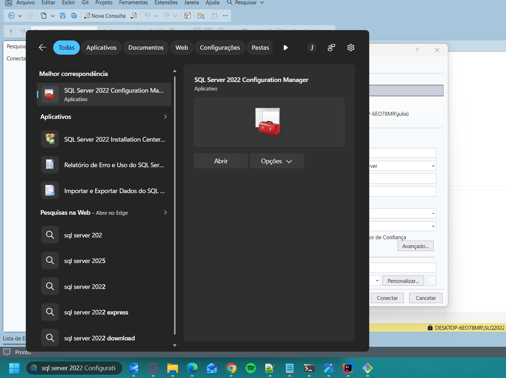
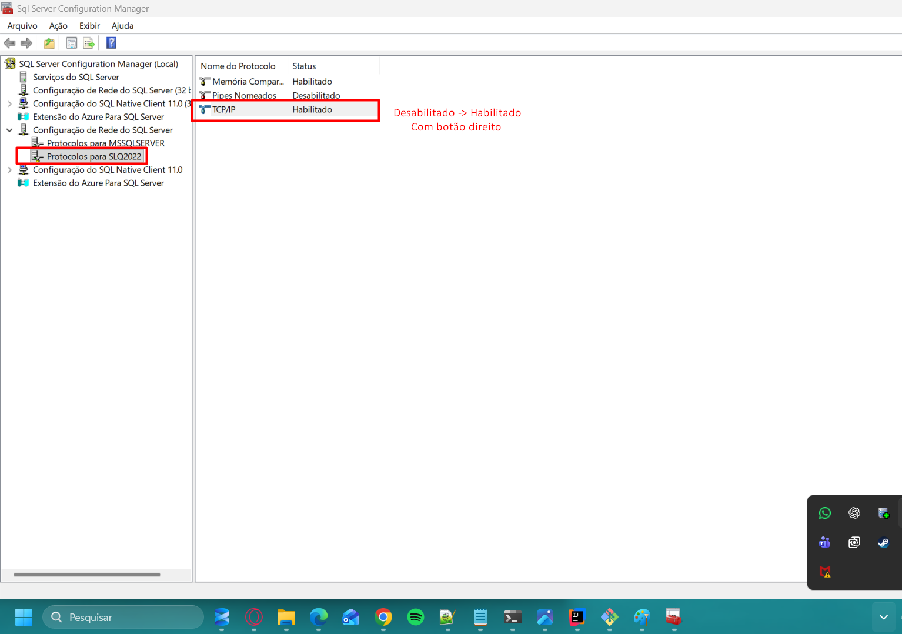
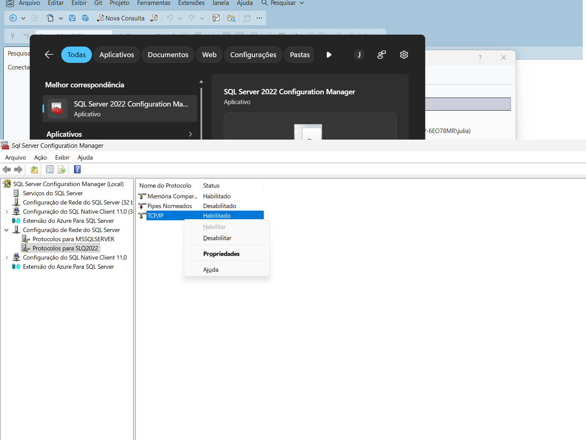
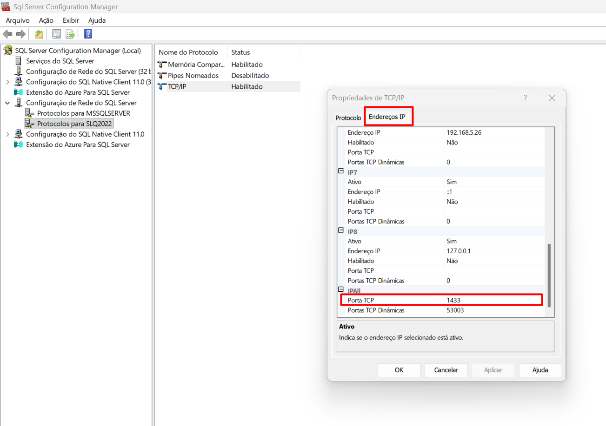
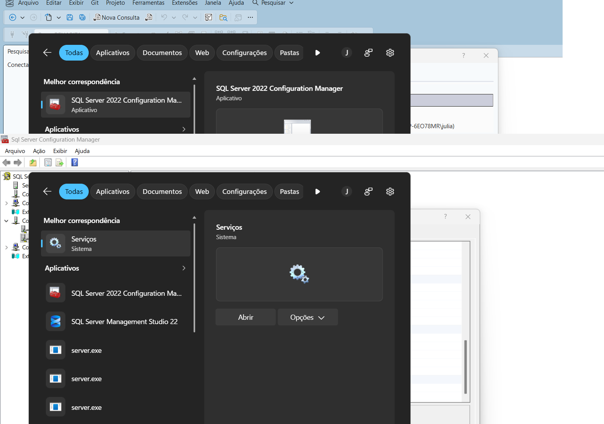
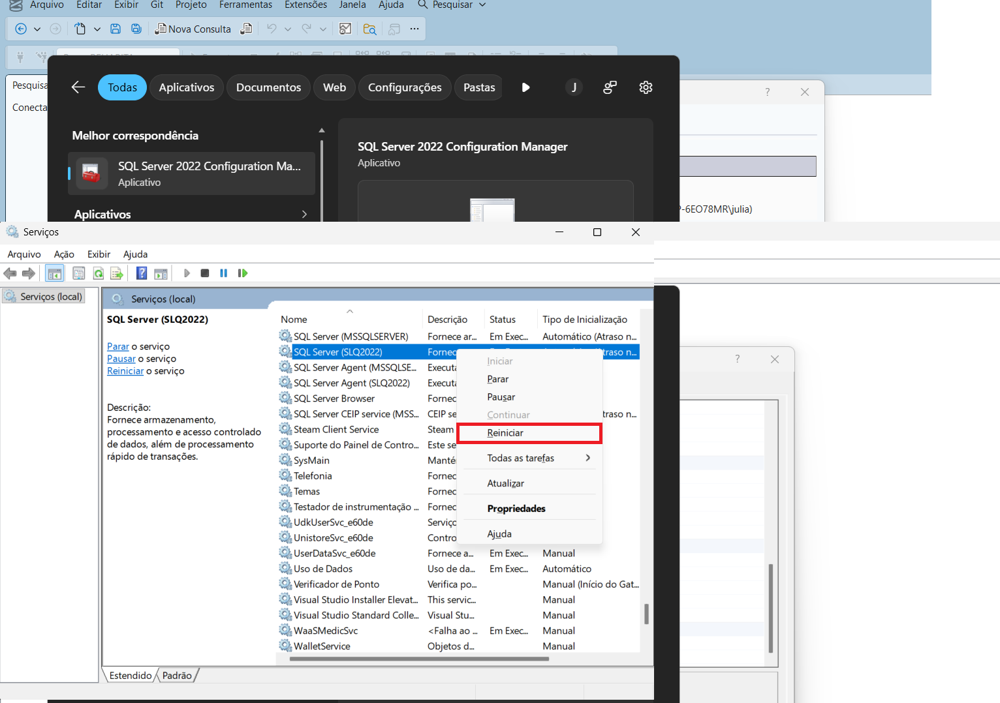
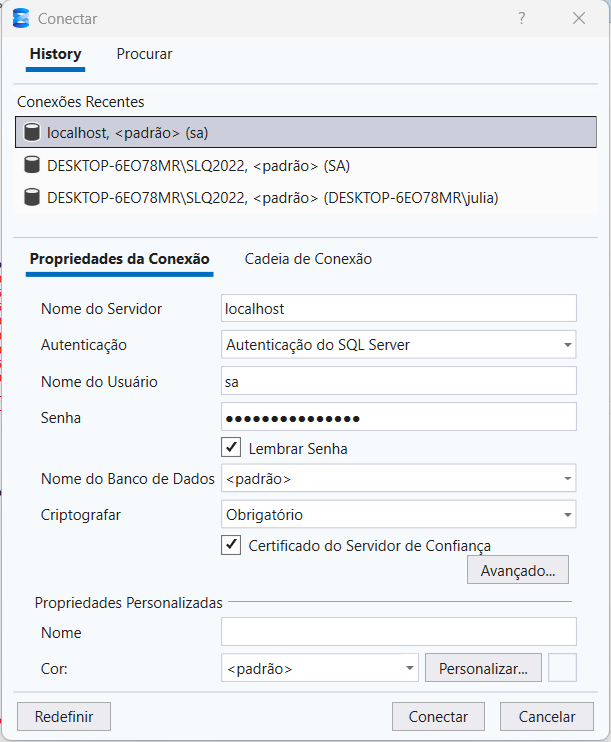

# Passo a Passo — Configuração do SQL Server para o REHABITA

Este guia mostra como habilitar a conexão TCP/IP na porta 1433 do SQL Server, que é necessária para o sistema Java se conectar ao banco de dados.

> **Por que precisa disso?** O SQL Server, por padrão, não aceita conexões TCP/IP. O Java (JDBC) se conecta pela rede usando TCP na porta 1433, então é preciso habilitar esse protocolo antes de rodar o sistema.

---

## Passo 1 — Abrir o SQL Server Configuration Manager

Na barra de pesquisa do Windows, digite **SQL Server 2022 Configuration Manager** e abra o aplicativo.

  

---

## Passo 2 — Habilitar o protocolo TCP/IP

No painel esquerdo, navegue até:

**Configuração de Rede do SQL Server → Protocolos para SLQ2022** (ou MSSQLSERVER, dependendo da sua instância).

Clique com o **botão direito** em **TCP/IP** e selecione **Habilitar**.

  

> **Atenção:** Se já estiver como "Habilitado", pode pular para o próximo passo.

---

## Passo 3 — Configurar a porta 1433

Ainda no TCP/IP, clique com o **botão direito** → **Propriedades**.

  

Na janela que abrir, vá na aba **Endereços IP** e role até o final, na seção **IPAll**.

Preencha:
- **Porta TCP:** `1433`
- **Portas TCP Dinâmicas:** pode deixar em branco ou como está

Clique em **Aplicar** e depois **OK**.

  

---

## Passo 4 — Abrir os Serviços do Windows

Na barra de pesquisa do Windows, digite **Serviços** e abra o aplicativo.

  

---

## Passo 5 — Reiniciar o serviço do SQL Server

Na lista de serviços, encontre **SQL Server (SLQ2022)** (ou **SQL Server (MSSQLSERVER)**, dependendo da sua instância).

Clique com o **botão direito** → **Reiniciar**.

  

> **Importante:** Sem reiniciar o serviço, a mudança da porta não entra em vigor.

---

## Passo 6 — Conectar pelo SSMS

Abra o **SQL Server Management Studio** e configure a conexão:

| Campo | Valor |
|-------|-------|
| **Nome do Servidor** | `localhost` |
| **Autenticação** | Autenticação do SQL Server |
| **Nome do Usuário** | `sa` |
| **Senha** | *(a senha que você definiu na instalação)* |

Clique em **Conectar**.

  

---

## Passo 7 — Executar o script do banco

Após conectar no SSMS:

1. Vá em **Arquivo → Abrir → Arquivo** e abra o `database/schema.sql` do projeto.
2. Aperte **F5** para executar.
3. O script cria o banco **BancoREHABITA**, as 11 tabelas e insere os dados de teste.

---

## Pronto!

Agora o SQL Server está configurado para receber conexões do Java via JDBC na porta 1433. Basta configurar a senha no arquivo `ConexaoBanco.java` e rodar o `Main.java`.

